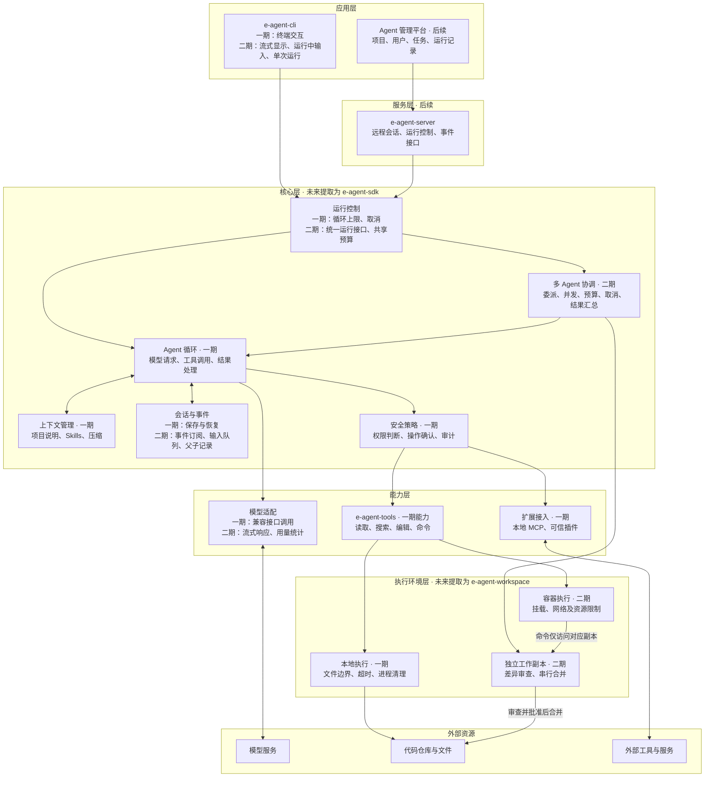

# e-agent

用 Python 从零实现一个面向代码任务的 Agent SDK，并在它之上构建 CLI、远程执行服务和开源 Agent 管理平台。

核心架构参考 OpenHands，教学组织借鉴极客兔兔的「7 天从零实现」系列：从小例子出发，逐章解释设计、实现关键路径、验证可观察的行为。

**当前状态：规划已更新，程序尚未实现。** 当前按两个阶段建设本地 Coding Agent，范围以 OpenSpec 中的任务、设计和能力规格为准。`docs/tutorial/` 保留早期 SDK 教程草稿，发生冲突时以当前规划为准；文中的目标目录、安装命令和示例 API 不代表已经发布的软件。

## 从这里开始

- [当前任务与阶段安排](openspec/changes/coding-agent-14-days/tasks.md)
- [当前设计与实现边界](openspec/changes/coding-agent-14-days/design.md)
- [当前范围与能力清单](openspec/changes/coding-agent-14-days/proposal.md)
- [教程目录与学习方式](docs/tutorial/README.md)
- [第零章 项目架构与边界](docs/tutorial/00-architecture.md)
- [第一章 模型与消息](docs/tutorial/01-model.md)
- [逐章验收清单](docs/tutorial/acceptance.md)
- [未来管理平台的边界](docs/tutorial/platform.md)
- [本地 OpenHands 源码与版本](docs/tutorial/references.md)

## 项目总体架构

下图展示整个项目的目标架构。节点中的「一期」「二期」「后续」表示计划实现的阶段，不表示已经完成。当前两个阶段先维护一个 Python 应用，图中的包名表示未来拆分后的职责。

CLI 和未来的 Server 复用同一套核心运行能力。Skills 和项目说明提供上下文，MCP 和插件提供工具扩展，均不另建 Agent 循环。

第一阶段的路径检查和操作确认不等于系统沙箱，命令仍使用当前用户权限。第二阶段为可写子任务增加容器执行和独立工作副本；宿主上的可信插件、MCP 服务不因此获得隔离。

## 实施阶段

| 阶段 | 开发单元 | 要完成的部分 |
| --- | --- | --- |
| 第一期：本地单 Agent | 第 1 到 14 单元 | REPL、模型调用、代码工具、Agent 循环、统一安全校验、Session、项目说明、Skills、本地 MCP、上下文压缩、可信插件和 CLI |
| 第二期：交互与协作 | 第 15 到 21 单元 | 运行事件、流式输出、运行中追加输入、无界面运行接口、只读子 Agent、共享预算与取消、容器隔离、独立副本和串行合并 |
| 后续规划 | 未安排工期 | 提取发布独立 SDK 及相关包、远程执行服务、Agent 管理平台；模型管理、会话分支等能力另行规划 |

第一期验收通过后再进入第二期。变更目录保留 `coding-agent-14-days` 名称，但当前计划包含 21 个开发单元；单元表示开发顺序，不承诺 14 天或 21 天完成。具体任务与验收条件见 [tasks.md](openspec/changes/coding-agent-14-days/tasks.md)。

## 最终产物

| 产物 | 职责 |
| --- | --- |
| `e-agent-sdk` | 模型协议、Agent 循环、Conversation、事件、工具协议和运行控制 |
| `e-agent-tools` | 文件读取、精确编辑、命令执行等开发工具 |
| `e-agent-workspace` | 本地与容器执行环境的具体实现 |
| `e-agent-cli` | 通过 SDK 提供终端交互 |
| `e-agent-server` | 通过 SDK 提供远程会话、运行和事件接口 |
| 后续管理平台 | 项目、用户、任务调度、运行记录、权限、资源与可视化 |

当前两个阶段不拆分发行包。第二阶段先提取不依赖终端的应用内运行接口，后续接口稳定后再拆成上述包；是否拆仓库另行决定。

## 参考项目

- [OpenHands](https://github.com/OpenHands/OpenHands)
- [OpenHands Software Agent SDK](https://github.com/OpenHands/software-agent-sdk)
- [7days-golang](https://github.com/geektutu/7days-golang)

教程采用自己的简化设计与命名，不承诺与 OpenHands API 兼容。
