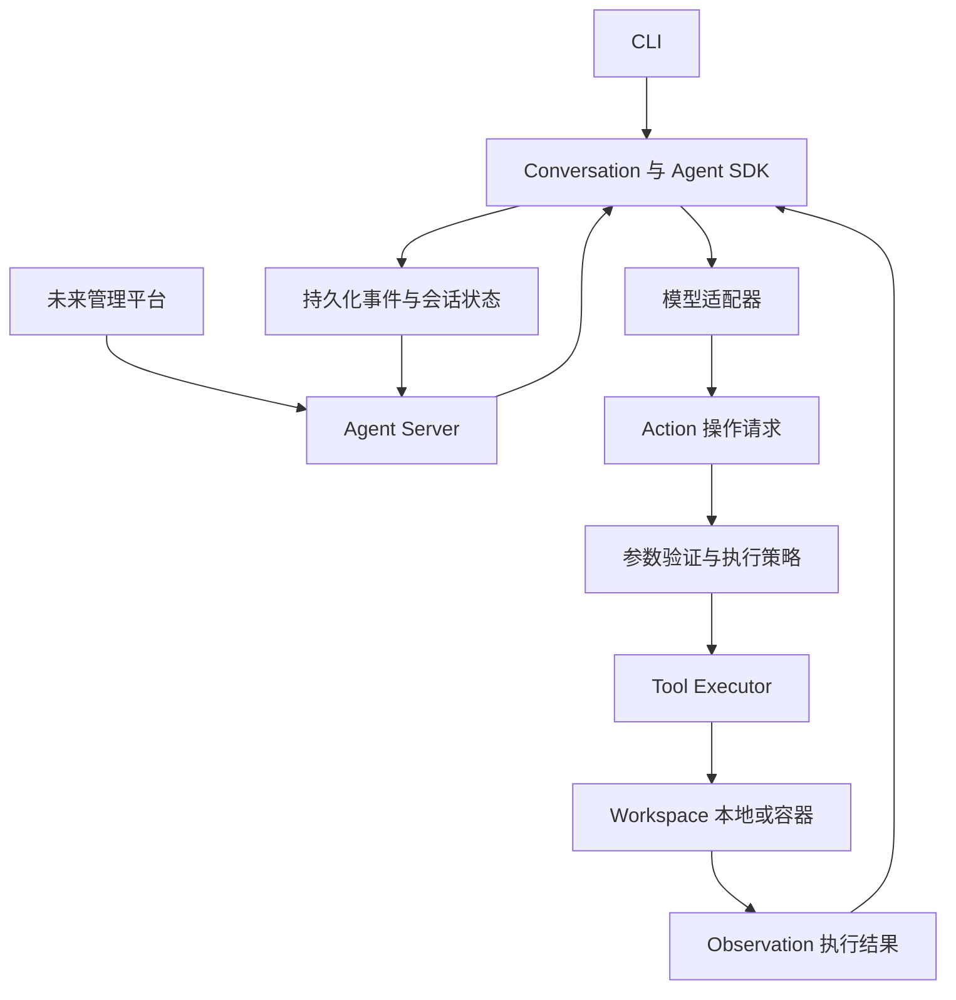

# 第零章 从 OpenHands 理解项目边界

[目录](README.md) · [下一章](01-model.md)

## 我们要实现什么

我们的目标是一个能理解代码任务、调用工具并持续推进的 Python SDK。CLI 是 SDK 的第一个使用者，未来的 Agent 管理平台是另一个使用者。因此业务循环应写在 SDK 中，CLI 和 HTTP 服务都只负责把外部输入转成 SDK 调用。

OpenHands 当前将 SDK 与应用分开；其 SDK 仓库还承载工具、Workspace 和 Agent Server，应用通过这些接口集成。这里借鉴的是职责边界，教程中的类名和协议是 e-agent 自己的设计。[OpenHands SDK 架构](https://docs.openhands.dev/sdk/arch/overview)

## 四种经常混淆的对象

**Agent** 是决策配置与行为：模型、提示词、工具集合和循环策略。一个 Agent 可以服务多个会话，因此不能把某个用户的历史偷偷保存在共享 Agent 对象上。

**Conversation** 是持续存在的会话：用户消息、工具结果、事件历史、工作区绑定。一段会话可以包含多次运行。

**Run** 是一次执行：从接受一条新需求到完成、失败、取消或达到限制。每次有独立 `run_id`、预算和终态，便于未来平台展示一次任务到底发生了什么。

**Workspace** 是执行环境：操作在哪个目录、进程或容器里发生，以及资源如何创建和清理。工具不直接决定在哪台机器运行。

例如，“修复计算错误”产生 run-1；用户随后说“补一个负数用例”产生 run-2。二者属于同一 Conversation，可以共享工作区和历史，但各自有明确的结果。

## 决策与执行分离



模型输出“运行测试”只是一个 Action，不能直接视为已经运行。执行器返回退出码、输出和失败原因之后，才得到 Observation。平台应根据持久化事件显示状态，不根据模型的自然语言猜测是否成功。

## 目标仓库布局

下面是逐章实现的目标结构，当前教程阶段尚未创建这些包。

```text
e-agent/
  docs/tutorial/
  packages/
    sdk/
      pyproject.toml
      src/e_agent/
        __init__.py
        models.py
        llm.py
        agent.py
        conversation.py
        events.py
        store.py
        policy.py
        context.py
        tools.py             # 工具协议与注册表
        workspace.py         # Workspace 协议
    tools/
      src/e_agent_tools/      # 内置代码工具
    workspace/
      src/e_agent_workspace/  # 本地与容器实现
    cli/
      src/e_agent_cli/
    server/
      src/e_agent_server/
  examples/
  tests/
    fixtures/buggy_project/
```

SDK 不导入 CLI、FastAPI、Docker 客户端或管理平台代码。工具包和 Workspace 包依赖 SDK 中的协议；CLI 与 Server 组装这些实现。模型提供方依赖可作为 SDK 的可选安装项。

先使用一个仓库便于同步修改教程和接口。独立 SDK 的验收标准是能单独构建、安装、导入并运行，而不只是目录名叫 `sdk`。

## 范围与演进

| 阶段 | 实现范围 | 明确的边界 |
| --- | --- | --- |
| 七章主线 | 单进程、本地工作区、确定性模型与真实模型适配器、文件工具、命令工具、事件、恢复、确认、CLI | 本地执行面向可信练习项目，不提供多租户隔离 |
| 远程执行进阶 | Agent Server、容器 Workspace、API、事件增量查询 | 先做单用户开发服务，运行进程与 HTTP 连接分离 |
| 平台阶段 | 用户项目、队列、Worker、授权、审计、配额、前端 | 多租户隔离、跨进程租约、外部 Agent 适配另行实现 |

模型 token 流、MCP、Skills、浏览器、多 Agent、向量索引都可以后续加入。第一版先确保执行、记录和恢复语义正确；事件流与模型 token 流是不同能力。

## 本章练习

画出“同一用户两次发送任务”的对象关系，标出 `conversation_id`、两次 `run_id` 和 `workspace_id`。再回答：如果 CLI 关闭，谁拥有任务？本地主线由 CLI 进程拥有；进阶版由服务端 Worker 拥有，浏览器关闭不应结束任务。

本章验收：任一核心类都能说明自己的状态归属；SDK 的公共接口不接收 HTTP Request，也不负责打印终端文本。
